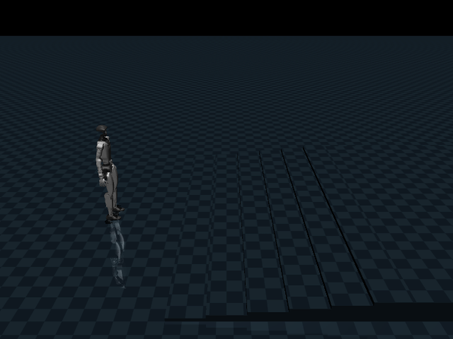

# G1 Robust Locomotion Lab

**Dự án RL humanoid chạy hoàn toàn trong mô phỏng, phát triển trên GTX 1660 Ti.**

Unitree G1 29 khớp • MuJoCo CPU • PPO / Stable-Baselines3 • Python 3.10+



Mục tiêu: học đi theo lệnh vận tốc, đánh giá khả năng giữ thăng bằng và mở rộng sang địa hình.
Mã cung cấp đầy đủ pipeline từ mô phỏng tới train/eval/report/demo. Chất lượng đi phải được
xác nhận bằng huấn luyện và benchmark; repo không kèm policy đã hội tụ.

## Thực nghiệm tự động trên máy 1660 Ti

Đã chạy học đứng, các pilot PPO từ đầu, khởi tạo bằng teacher Unitree, DAgger và fine-tune PPO.
Checkpoint và video nằm trong `runs/autonomous-1660/` và `artifacts/autonomous-1660/` tại máy
phát triển (không được git theo dõi). Kết quả định lượng và giới hạn nằm trong
[báo cáo thực nghiệm](docs/EXPERIMENT_1660.md).

Policy có khả năng đi hiện tại được khởi tạo từ **policy Unitree đã có sẵn**, không phải
PPO tự học đi từ đầu. Robot vẫn là mô hình G1 29 khớp; ở chế độ này 12 khớp chân nhận
action của policy, thân trên giữ tư thế bằng PD. Cấu hình actuator và observation được lưu
trong từng bundle và tự khôi phục khi eval/demo.

```bash
bash scripts/fetch_teacher.sh
g1lab eval --teacher vendor/unitree_rl_gym --output artifacts/teacher-check --episodes 3 --seconds 30
g1lab bootstrap --run runs/bootstrap --samples 16000 --epochs 100
python scripts/dagger.py --bundle runs/bootstrap/final --data runs/bootstrap/teacher-data.npz --run runs/dagger
python scripts/finetune_campaign.py --bundle runs/dagger/round-7 --run runs/anchored \
  --steps 8192 --anchor-data runs/dagger/aggregated-data.npz
```

`round-7` là ví dụ checkpoint; chọn bằng validation seed riêng trước khi chạy đánh giá cuối.
Fine-tune có anchor là **PPO + BC anchoring**, không phải PPO thuần. Script lưu cả các ứng viên
bị loại khi làm mất khả năng đi. Chạy lại thực nghiệm không bảo đảm cùng chất lượng.

```bash
g1lab demo --bundle runs/dagger/round-7 --auto
```

`--auto` tự chạy chu kỳ đứng → đi → quay nhẹ → dừng. Không truyền `--auto` để điều khiển bằng phím.

Checkpoint có sẵn tại máy phát triển:

```bash
# Mặc định: đứng/đi/ngang/quay, có thích nghi dốc nhẹ
g1lab demo --bundle runs/autonomous-1660/selected-terrain --auto
# Bản trước thích nghi dốc giữ tỷ lệ vượt rough thấp tốt hơn
g1lab demo --bundle runs/autonomous-1660/selected --terrain rough --difficulty 0.2 --auto
```

Hai checkpoint được đóng gói local trong `artifacts/g1-1660-checkpoints.zip`.

## Vì sao dùng CPU MuJoCo ở bản này?

Máy phát triển có GTX 1660 Ti Mobile 6 GB và Ryzen 5 4600H. MuJoCo chuẩn chạy physics
trên CPU; PPO MLP nhỏ mặc định dùng CPU, không đòi hỏi CUDA. GPU có thể dùng cho render.
Đây là environment riêng dựa trên Menagerie,
**không phải bản huấn luyện mjlab**. Đổi `--device cuda` chỉ chuyển mạng PPO, không đưa physics lên GPU.

## Cài đặt

```bash
python3 -m venv .venv
source .venv/bin/activate
python -m pip install torch==2.6.0 --index-url https://download.pytorch.org/whl/cpu
python -m pip install -e '.[dev]'
g1lab doctor
PYTEST_DISABLE_PLUGIN_AUTOLOAD=1 pytest -q
```

G1 XML và meshes đã nằm trong repo, không cần tải robot khi chạy. Giấy phép nguồn ở
`src/g1lab/assets/g1/LICENSE`, provenance ở [THIRD_PARTY.md](THIRD_PARTY.md).
Trên Python 3.10 Linux, `bash scripts/install_cpu.sh` cài theo dependency snapshot
`requirements-lock.txt` đã dùng để kiểm chứng. Các Python khác có thể cần resolve dependencies lại.
Nếu `venv` chưa có: cài gói `python3-venv` bằng package manager của hệ điều hành.

## Kiểm tra nhanh toàn bộ pipeline

Mỗi thư mục output phải mới để tránh ghi đè dữ liệu thí nghiệm.

```bash
g1lab benchmark --steps 1000
g1lab train --run runs/smoke --steps 1024 --rollout 128 --checkpoint-every 512
g1lab eval --bundle runs/smoke/final --output artifacts/smoke-eval --episodes 2 --seconds 2
g1lab report artifacts/smoke-eval --output artifacts/smoke-report
```

Smoke training chỉ xác nhận hệ thống chạy, không chứng minh robot đã học đi.

## Huấn luyện trên máy 1660 Ti

```bash
# Baseline, một môi trường và hai CPU threads để bắt đầu
g1lab train --config configs/flat.json --run runs/flat-42 --steps 1000000 --seed 42

# Nhiều tiến trình physics nếu CPU/RAM cho phép; đo tốc độ trước khi tăng
g1lab train --config configs/flat.json --run runs/flat-workers --steps 1000000 --envs 2 --workers

# Fine-tune chống nhiễu, giữ đúng policy và observation statistics
g1lab train --config configs/robust.json --run runs/robust-42 --steps 1000000 --resume runs/flat-42/final

# Curriculum theo ngân sách: phẳng → chống nhiễu → dốc 2/4 độ → rough 1.2/2.4 cm
g1lab curriculum --run runs/curriculum-42 --steps-per-stage 1000000

tensorboard --logdir runs
```

Ngân sách trên là ví dụ, không bảo đảm hội tụ. PPO làm tròn theo kích thước rollout.
Curriculum chuyển stage theo ngân sách bước, chưa tự đánh giá để quyết định chuyển cấp.
Fine-tune tuần tự có thể quên kỹ năng cũ; phải chạy full suite sau mỗi stage.
Resume tạo run mới, không khôi phục chính xác trạng thái RNG/rollout vật lý giữa chừng.
Các stage dùng cùng observation/action space và giữ chuẩn hóa; optimizer được tải từ checkpoint.
Ctrl+C lưu bundle `final/`; checkpoint định kỳ nằm trong `checkpoints/step-N/`.
Chỉ bundle có marker `COMPLETE` mới được tải. Không tráo file statistics giữa các policy.

## Đánh giá và so sánh

```bash
# PD tham chiếu, không có policy học
g1lab eval --output artifacts/pd --suite full --episodes 10

# Seed đánh giá mặc định bắt đầu từ 10000, tách seed train
g1lab eval --bundle runs/flat-42/final --output artifacts/flat-42 --suite full --episodes 10
g1lab eval --bundle runs/robust-42/final --output artifacts/robust-42 --suite full --episodes 10
g1lab report artifacts/flat-42 artifacts/robust-42 --output artifacts/comparison
```

Full suite: đứng, tiến, ngang, quay, đổi lệnh, ma sát, mass scale, dốc, rough, cầu thang,
và lực đẩy 2/5/10 N·s theo hai hướng. Không có policy cầu thang được bảo đảm sẵn.
Output: `protocol.json`, `episodes.csv`, `summary.json`, trajectory CSV từng episode,
và video nếu thêm `--video`. Report xuất PNG và Markdown.
Xem [giao thức đo lường](docs/EVALUATION.md) trước khi kết luận chất lượng.

## Demo trực tiếp

```bash
g1lab demo                                      # PD diagnostic, chưa học đi
g1lab demo --bundle runs/flat-42/final
g1lab demo --bundle runs/flat-42/final --terrain slope --difficulty 0.3
```

Cửa sổ MuJoCo: W/S thay vận tốc tiến, A/D vận tốc ngang, Q/E tốc độ quay,
X dừng, P đẩy ngang 5 N·s, R reset. Lệnh và trạng thái hiển thị trong terminal.
Đóng cửa sổ để thoát. GUI cần desktop/display hoạt động; không dùng được trong terminal headless.

Video headless cần backend OpenGL hợp lệ. Thử `MUJOCO_GL=egl` nếu EGL hoạt động;
hoặc `MUJOCO_GL=osmesa` nếu hệ thống có libOSMesa. Cài CPU torch không sửa NVIDIA driver.
Trong sandbox có thể không truy cập được NVIDIA dù driver trên máy vẫn hoạt động;
chạy `nvidia-smi` trực tiếp trên máy để phân biệt. ROS có thể tự nạp pytest plugin ngoài
venv; `PYTEST_DISABLE_PLUGIN_AUTOLOAD=1` cô lập các bài kiểm thử của repo.

## Địa hình

| Loại | Tham số difficulty ∈ [0,1] |
|---|---|
| Flat | Mặt phẳng, có thể đổi ma sát |
| Slope | Dốc theo hướng +X, góc = 10 × difficulty độ |
| Rough | Heightfield nhiễu trơn theo seed, biên độ tối đa 6 × difficulty cm |
| Stairs | 6 bậc, mỗi bậc cao 10 × difficulty cm, mặt bậc sâu 40 cm |

Terrain scan 15 điểm được đưa vào observation ở mọi địa hình để giữ cùng kiến trúc policy.
Scan là dữ liệu hình học chính xác từ simulator, chưa mô phỏng camera hoặc nhiễu cảm biến.

## Cấu trúc

```text
src/g1lab/env.py          Physics, observations, reward, pushes, randomization
src/g1lab/terrain.py      Terrain generation
src/g1lab/training.py     PPO, checkpoint, resume
src/g1lab/curriculum.py   Staged curriculum
src/g1lab/evaluation.py   Evaluation protocol and trajectory exports
src/g1lab/demo.py         Interactive viewer
src/g1lab/report.py       Comparison figures
configs/                 Training scenarios
tests/                   Physics/API/reproducibility/checkpoint regression tests
legacy/                  Original generic Humanoid-v5 prototype
```

## Chuyển sang RTX 5090

Mã này chạy được trên máy mạnh hơn nhưng physics vẫn CPU. Có thể tăng worker theo CPU/RAM;
GPU không bảo đảm nhanh hơn cho PPO MLP nhỏ. Muốn mô phỏng GPU hàng loạt cần port task sang
mjlab/MuJoCo Warp, đối chiếu observation, reward, timestep và actuator. Checkpoint SB3 không tự
chuyển thành checkpoint của trainer khác. AMP và backend GPU là hướng mở rộng, chưa triển khai.

## Trạng thái kiểm chứng

Xem [VALIDATION.md](docs/VALIDATION.md). Không có kết quả nào trong repo được trình bày là
policy đã hội tụ nếu chỉ mới chạy smoke test. Dự án không có mã điều khiển robot thật.
