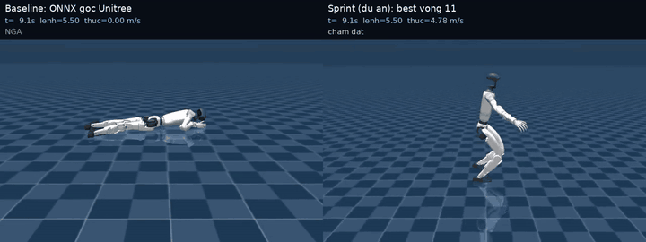

# G1 Robust Locomotion Lab

**Dự án RL cho humanoid Unitree G1 29 khớp, chạy hoàn toàn trong mô phỏng.**
Hướng hiện tại: dạy G1 **chạy bứt tốc có pha bay**, giữ thăng bằng, giảm tốc và dừng được.

Isaac Sim 5.1 / Isaac Lab 2.3.2 (PhysX, train) • RSL-RL PPO • MuJoCo (đánh giá độc lập) • RTX 5090

## Kết quả (17/11/2026)



| Chấm MuJoCo, 10 seed mới × giữ 60 s, cùng mô hình động cơ | Baseline (ONNX công khai Unitree) | **Policy sprint** |
|---|---|---|
| Tốc độ cao nhất đạt 10/10 | 1,0 m/s | **lệnh 5,5 → thực 4,94 m/s** |
| Lệnh 2,0 m/s | ngã 10/10 sau ~6 s | 2,08 m/s, 10/10 |
| Dáng | đi bộ, 0 % pha bay | chạy, **pha bay 46 %**, chạm đất 0,13 s |
| Giảm tốc và dừng | có | có, mọi mức tới 5,5 m/s |
| Tốc độ khớp cao nhất / định mức | — | 72 % |

Video cạnh nhau (trái baseline, phải dự án): [1,5](docs/media/baseline-vs-sprint-1.5.mp4) ·
[3,0](docs/media/baseline-vs-sprint-3.0.mp4) · [4,0](docs/media/baseline-vs-sprint-4.0.mp4) ·
[5,5 m/s](docs/media/baseline-vs-sprint-5.5.mp4). Policy: [models/g1-sprint-v2-r11/](models/g1-sprint-v2-r11/).

**Báo cáo đầy đủ — kiến trúc, công cụ, thiết kế reward, động cơ, quy trình, sự cố, hạn chế:**
[docs/G1_SPRINT_REPORT.md](docs/G1_SPRINT_REPORT.md).

Chưa đạt: tiếp đất bằng gót (yêu cầu mũi chân), chưa đánh tay, dáng còn khuỵu, nhịp bước chưa tăng theo tốc độ.
Train tiếp từ policy này đang bị sụp trong vài trăm iteration đầu; nguyên nhân đang được tách bằng thí nghiệm.
11 m/s là trần nghiên cứu, **không phải cam kết** (bài báo SPRINT công bố ~6 m/s trên G1). Giới hạn mô-men, tốc
độ khớp, gain PD và mô hình robot không bị nới để làm đẹp kết quả.

## Luồng làm việc

```text
Isaac Lab (PhysX, GPU1)              export                 MuJoCo (CPU, độc lập)
task Sprint, PPO 4096 env  ──►  policy.onnx + deploy.yaml  ──►  thang tốc độ, 10 seed mới,
đánh giá thang tốc độ 1→11 m/s                                 giữ 60 s, dừng, số đo pha bay
```

Isaac là simulator để **train**; MuJoCo là simulator **chấm kết quả**. Hai simulator không được mặc định
cho cùng kết quả, nên mọi con số đều ghi rõ đo bằng simulator nào.

## Phát hiện quan trọng

- **Gain PD.** `deploy.yaml` đi kèm ONNX v0 dùng kp = 200 ở eo roll/pitch và kd = 10 ở 14 khớp tay; robot
  config của revision Unitree đang ghim dùng 40 và 1. Với gain v0, actor ONNX đi được trong PhysX (100% sống
  ở 1,5 m/s, 1,37 m/s, gần MuJoCo); với gain vendor nó ngã hết từ 1 m/s. Mọi task của dự án dùng gain v0
  (`Unitree-G1-29dof-Velocity-G1LabV0Gains`), đăng ký phía project, không sửa vendor.
- **Resume.** `train.py` của vendor bỏ qua `--experiment_name`; launcher dùng Hydra override
  `agent.experiment_name` để resume tìm đúng checkpoint.
- **Lực ngang.** Cảm biến tiếp xúc Isaac chỉ cho lực pháp tuyến; lực đẩy ngang được tính từ Σ mᵢaᵢ.
- **Chạy offline.** Mặt đất "plane" mặc định tải từ cloud NVIDIA; task Sprint dùng mặt đất sinh tại chỗ.

## Task Sprint

`Unitree-G1-29dof-Sprint-G1Lab` ([src/g1lab/isaac_sprint.py](src/g1lab/isaac_sprint.py)) giữ nguyên quan sát
và action (480 → 29), nên vẫn ghép được actor ONNX.

- **Reward:** 19 term gốc Unitree + 20 term chạy nước rút (pha bay, chạm đất ngắn, cadence theo tốc độ, lực đẩy
  ngang Σ mᵢaᵢ, tiếp đất mũi chân, đặt chân dưới thân, nâng gối, gập cổ chân, mô-men động lượng thấp, đổ người
  theo gia tốc, chạy thẳng, biên độ động cơ, phạt ngã −200). Bám tốc độ có dung sai σ = max(0,5; 0,15·v).
- **Cổng tốc độ:** dưới 1,6 m/s reward giống task đi bộ gốc; từ 1,6 đến 2,2 m/s chuyển dần sang reward chạy.
- **Chống lách reward (v3):** thưởng dáng chạy dương chỉ được trả theo tỷ lệ bám tốc độ.
- **Động cơ theo thông số** ([actuator_spec.py](src/g1lab/actuator_spec.py)), dùng chung cho Isaac và MuJoCo:
  đỉnh mô-men theo mô hình MuJoCo + đường cong mô-men–tốc độ N7520, trễ 0–20 ms. **Domain randomization:** ma sát,
  khối lượng, trọng tâm, gain PD, armature, đẩy ngẫu nhiên.
- **Pha bước không dùng đồng hồ:** cảm biến bàn chân ngưỡng 20 N, khử nhiễu 40 ms.
- **Lệnh tốc độ có giới hạn gia tốc:** mỗi tập xuất phát từ đứng yên, có giảm tốc và dừng; curriculum tới 11 m/s.

Bảng trọng số và lý do từng thay đổi: [báo cáo, mục 4](docs/G1_SPRINT_REPORT.md#4-thiết-kế-phần-thưởng).

## Cài đặt

Dùng **hai môi trường riêng**; không cài Torch CPU vào môi trường train.

**A. Đánh giá MuJoCo** (Python 3.10, Torch CPU là cố ý):

```bash
python3.10 -m venv .venv-eval
.venv-eval/bin/python -m pip install torch==2.6.0 --index-url https://download.pytorch.org/whl/cpu
.venv-eval/bin/python -m pip install -e '.[dev,lab]' -c requirements-lock.txt
PYTEST_DISABLE_PLUGIN_AUTOLOAD=1 .venv-eval/bin/python -m pytest -q
```

**B. Train Isaac** (Python 3.11): Isaac Sim 5.1.0 (pip), Torch 2.7.0+cu128, Isaac Lab v2.3.2 (source),
RSL-RL 3.1.2, `vendor/unitree_rl_lab` (editable), project cài `--no-deps`. Luôn cài với
[file constraints](docs/experiment-data/5090-bringup/isaac51-constraints.txt): `isaaclab.sh --install` dùng
`uv` và có thể tự nâng Torch lên bản CUDA 13. Từng bước và lý do: [docs/RTX_5090_BRINGUP.md](docs/RTX_5090_BRINGUP.md).

Asset USD G1 29 khớp lấy từ [unitreerobotics/unitree_model](https://huggingface.co/datasets/unitreerobotics/unitree_model),
giữ nguyên cấu trúc thư mục; đường dẫn truyền qua `--usd`.

### Chỉ dùng một GPU

[src/g1lab/gpu.py](src/g1lab/gpu.py) ghim CUDA theo **UUID** của GPU dành cho dự án, đặt
`CUDA_DEVICE_ORDER=PCI_BUS_ID`, và **từ chối** mọi `CUDA_VISIBLE_DEVICES` khác. Render MuJoCo/EGL cũng ghim
theo địa chỉ PCI. Kit chạy với multi-GPU tắt. UUID, PCI và `activeGpu` hiện đặt cho máy phát triển; trên máy
khác, đặt `G1LAB_GPU_UUID`/`G1LAB_GPU_PCI` và kiểm tra lại `KIT_ARGS`. Đừng tự đặt `CUDA_VISIBLE_DEVICES`.

## Chạy

Mỗi thư mục output phải mới. `python` là interpreter Isaac; `$USD` là đường dẫn
`.../G1/29dof/usd/g1_29dof_rev_1_0/g1_29dof_rev_1_0.usd`.

```bash
# Tái hiện baseline (MuJoCo)
.venv-eval/bin/python scripts/tune_lab_controller.py --output artifacts/baseline-check
.venv-eval/bin/python scripts/benchmark_lab_policy.py --heading-hold --output artifacts/heading-check

# Preflight và smoke Isaac
python scripts/check_training_host.py --usd "$USD" --output artifacts/host.json --require-training
python scripts/prepare_lab_fast.py --usd "$USD" --cap 1 --envs 32 --iterations 2 --output artifacts/smoke --execute

# Checkpoint khởi tạo từ actor ONNX (template = checkpoint bất kỳ cùng kiến trúc, ví dụ từ smoke)
python scripts/onnx_to_rslrl.py --std 0.1 --seed 0 \
  --onnx vendor/unitree_rl_lab/deploy/robots/g1_29dof/config/policy/velocity/v0/exported/policy.onnx \
  --template <smoke_run>/model_0.pt --output checkpoints/onnx-v0-std0.1/model_0.pt

# Một lượt train task Sprint
python scripts/prepare_lab_fast.py --profile sprint --usd "$USD" --envs 4096 --iterations 600 \
  --checkpoint checkpoints/onnx-v0-std0.1/model_0.pt --critic-warmup 20 --output artifacts/sprint-01 --execute

# Đánh giá: thang tốc độ Isaac, export, thang tốc độ MuJoCo kèm số đo pha bay
python scripts/isaac_sprint_eval.py --policy <run>/model_N.pt --usd "$USD" --speeds 1,2,3,4,5 --output <json>
python scripts/export_rslrl_onnx.py --checkpoint <run>/model_N.pt --output artifacts/policies/<name>
.venv-eval/bin/python scripts/mujoco_sprint_eval.py --policy-dir artifacts/policies/<name> --speeds 1,1.5,2 --output <json>

# Video MuJoCo so sánh với baseline (EGL trên GPU dự án)
.venv-eval/bin/python scripts/render_compare.py --right-policy models/g1-sprint-v2-r11 --speed 5.5 --output <mp4>
```

### Autopilot (train không người trông, không cần mạng)

```bash
setsid nohup .venv-eval/bin/python scripts/autopilot_sprint.py --output artifacts/autopilot-<tên> \
  --init-checkpoint checkpoints/onnx-v0-std0.1/model_0.pt --usd "$USD" --hours 0 \
  --envs 4096 --round-iterations 600 --speed-limit 11.0 > artifacts/autopilot-<tên>.out 2>&1 &

cat artifacts/autopilot-<tên>/REPORT.md                                # tiến độ, bản tốt nhất, kiểm chứng
echo '{"stop": true}' > artifacts/autopilot-<tên>/control.json        # dừng êm sau vòng hiện tại
```

`--hours 0` nghĩa là chạy đến khi có lệnh dừng. Mỗi vòng: train 600 iteration → thang tốc độ Isaac → export →
MuJoCo chạy nền; bản tốt nhất mới được kiểm chứng MuJoCo 10 seed × 60 s. Tự rollback về policy đã kiểm chứng
khi tụt tốc độ, NaN hoặc std âm; chặn lỗi khởi động lặp; tự nâng curriculum. Mọi tiến trình con chạy không mạng
(`unshare -rn`), có luồng canh GPU khác. Theo dõi offline: `python3 scripts/autopilot_dashboard.py --run <run>
--watch 60` rồi mở `<run>/dashboard.html`. Quy tắc đầy đủ: [docs/AUTOPILOT.md](docs/AUTOPILOT.md).

## Tiêu chí đánh giá

| Simulator | Đạt |
|---|---|
| Isaac (thang tốc độ) | Xuất phát từ đứng yên, tăng tốc 2 m/s², giữ 10 s, 2 seed × 32 robot: ≥ 90% robot sống, vx trung bình ≥ 85% lệnh, RMS quay < 0,25 rad/s, lệch hướng < 30° |
| MuJoCo (chấm cuối) | Đứng → tăng tốc → giữ 60 s → giảm tốc → dừng: không ngã, vx ≥ 85% lệnh, RMSE phẳng ≤ max(0,15; 20% lệnh), RMS quay < 0,25 rad/s, lệch hướng < 30°, tốc độ cuối < 0,15 m/s |

Số đo kỹ thuật chạy được báo cáo kèm (MuJoCo 500 Hz, ngưỡng 20 N, khử nhiễu 40 ms): tỷ lệ pha bay, hai chân
cùng chạm, thời gian chạm/vung, cadence, tỷ lệ tiếp đất mũi/gót, lực ngang đỉnh, độ nâng gối, độ gập cổ chân,
biên độ và tương quan tay–chân, góc ngả thân. Ngưỡng bắt buộc cho pha bay chưa được chốt.

## Cấu trúc

```text
src/g1lab/isaac_sprint.py     Task Sprint: lệnh tốc độ giới hạn gia tốc, theo dõi pha bước, reward, DR, terrain offline
src/g1lab/actuator_spec.py    Mô hình động cơ chung Isaac/MuJoCo (đỉnh mô-men, đường cong N7520)
src/g1lab/isaac_v0_cfg.py     Task velocity với gain PD của ONNX v0
src/g1lab/isaac_tasks.py      Đăng ký task (entry point dạng chuỗi, không cần Isaac khi import)
src/g1lab/gpu.py              Ghim GPU (CUDA theo UUID, EGL theo PCI, tham số Kit)
src/g1lab/fast_plan.py        Lệnh train Isaac (speed-stage, sprint)
src/g1lab/gait_metrics.py     Số đo kỹ thuật chạy (thuần numpy)
src/g1lab/lab_policy.py       Chạy policy ONNX 29 khớp trong MuJoCo (+ telemetry chỉ đọc)
src/g1lab/lab_evaluation.py   Kịch bản đứng/tăng tốc/giữ/giảm tốc/dừng và tiêu chí đạt
scripts/autopilot_sprint.py   Vòng lặp train/đánh giá/tự xử lý không người trông
scripts/autopilot_dashboard.py Dashboard HTML/terminal offline cho một lượt autopilot
scripts/render_compare.py     Video MuJoCo hai policy cạnh nhau
scripts/isaac_train.py        Wrapper train.py của vendor: đăng ký task, warm-up critic
scripts/prepare_lab_fast.py   Launcher train Isaac + provenance
scripts/onnx_to_rslrl.py      ONNX → checkpoint RSL-RL
scripts/export_rslrl_onnx.py  Checkpoint → policy.onnx + deploy.yaml
scripts/isaac_sprint_eval.py  Thang tốc độ trong Isaac
scripts/mujoco_sprint_eval.py Thang tốc độ trong MuJoCo kèm số đo pha bay
scripts/isaac_sprint_probe.py Kiểm tra dấu/độ lớn các term reward
vendor/                       unitree_rl_lab, unitree_mujoco (revision ghim)
models/g1-sprint-v2-r11/      Policy sprint tốt nhất (ONNX, deploy.yaml, checkpoint RSL-RL)
docs/media/                   Video/GIF so sánh với baseline
docs/experiment-data/         Số liệu nhỏ đi kèm các báo cáo
legacy/, src/g1lab/env.py ... Pipeline MuJoCo/SB3 thời 1660 (xem bên dưới)
```

## Lịch sử: pipeline MuJoCo/SB3 trên GTX 1660 Ti

Trước RTX 5090, dự án chạy trên máy GTX 1660 Ti 6 GB với môi trường MuJoCo CPU riêng và PPO
Stable-Baselines3 (CLI `g1lab`: train/eval/curriculum/report/demo, địa hình phẳng/dốc/gồ ghề/cầu thang).
Pipeline này vẫn còn trong repo và test vẫn chạy, nhưng không còn là hướng chính. Checkpoint SB3 dùng
teacher chân 12 khớp, không resume được bằng RSL-RL.

- [Báo cáo dọn mã và 46 lượt thử bộ giữ hướng](docs/CLEANUP_1660_REPORT.md)
- [Tích hợp Unitree RL Lab 29 khớp](docs/UNITREE_RL_LAB.md) · [Đo tốc độ policy Unitree gốc](docs/UNITREE_SPEED.md)
- [Thực nghiệm 1660](docs/EXPERIMENT_1660.md) · [trộn địa hình](docs/EXPERIMENT_MIXED_1660.md) ·
  [giữ kỹ năng bằng replay](docs/EXPERIMENT_PRESERVATION_1660.md) · [chạy tiếp tại máy](docs/LOCAL_TRAINING.md)
- [Giao thức đánh giá](docs/EVALUATION.md) · [Demo 16 môi trường](docs/SWARM_DEMO.md)
- [Pilot tự đứng dậy](docs/RECOVERY.md) — tạm dừng, không nằm trong phạm vi hiện tại

## Tài liệu

- [Bring-up RTX 5090](docs/RTX_5090_BRINGUP.md): môi trường, số đo quy mô env, gain v0, khởi tạo
- **[Báo cáo dự án G1 Sprint](docs/G1_SPRINT_REPORT.md)** · [Autopilot](docs/AUTOPILOT.md) ·
  [Thiết kế task Sprint v1 (lưu trữ)](docs/SPRINT_TASK.md)
- [Đánh giá SPRINT (arXiv 2605.28549) và kế hoạch tích hợp](docs/SPRINT_INTEGRATION.md): chưa có code/data công khai
- [Bàn giao 5090](docs/CLAUDE_5090_START_HERE.md) · [Trạng thái kiểm chứng](docs/VALIDATION.md)
- Provenance và giấy phép: [THIRD_PARTY.md](THIRD_PARTY.md)

Dự án chỉ chạy trong mô phỏng; không có mã điều khiển robot thật. Smoke test hoặc lượt train thành công
không có nghĩa là policy đã học chạy. Chỉ benchmark MuJoCo trên seed mới mới được dùng để kết luận.
