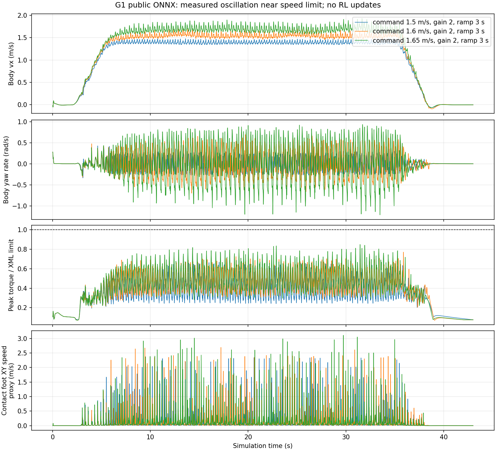

# Báo cáo dọn mã và triển khai trên GTX 1660 Ti

Đợt này đã hoàn tất benchmark/tối ưu bộ điều khiển và chuẩn bị chuyển máy; **không huấn luyện
policy RL mới**. Mốc tốc độ đạt chuẩn chưa tăng so với đợt trước. Không đổi policy mặc định chỉ
vì một chỉ số dao động nhỏ hơn.

## Mã đã chỉnh

- Tách engine đánh giá khỏi CLI thành `src/g1lab/lab_evaluation.py`; benchmark cũ và bộ quét mới
  dùng chung lịch điều khiển, tiêu chí đạt và cách tính số đo.
- Cho phép cấu hình hệ số giữ hướng và thời gian tăng/giảm tốc. Không thay trọng số ONNX,
  giới hạn actuator, mô hình robot hoặc ngưỡng đạt để làm đẹp kết quả.
- Bổ sung telemetry tùy chọn: nghiêng thân, tỷ lệ yêu cầu mô-men vượt giới hạn ở cả 10 substep,
  mức sử dụng mô-men và tốc độ thân bàn chân trong thời gian tiếp đất.
- Thêm `scripts/tune_lab_controller.py`: quét hữu hạn, chọn bằng seed phát triển, đánh giá bằng
  10 seed riêng; lưu cả lượt bị loại, protocol và summary.
- Thêm script vẽ chẩn đoán, dựng video có xác nhận OpenGL NVIDIA, kiểm tra host CUDA/Isaac.
- Sửa tạo lệnh Hydra cho đường dẫn USD có khoảng trắng và escape tên checkpoint dùng như regex.
- CI kiểm tra cả lint, format và test; cài thêm optional dependency phục vụ tích hợp Lab.
- README ghi rõ pilot đứng dậy đang lưu trữ; bổ sung tài liệu chuyển RTX 5090.

## Thực nghiệm thực sự đã chạy

Host: GTX 1660 Ti 6 GB, driver 595.99.02, RAM khoảng 16 GB. Python hiện tại dùng
Torch 2.6.0 CPU, MuJoCo 3.3.7, ONNX Runtime 1.22.0. Báo cáo host nằm ở
[host.json](experiment-data/controller-1660-v1/host.json).

Bộ quét gồm 3 mức lệnh (1,5; 1,6; 1,65 m/s), 3 hệ số giữ hướng (1; 2; 4), 2 thời gian ramp
(3; 5 giây), mỗi cấu hình 2 seed: **36 lượt phát triển**. Sau đó **10 lượt validation** với
seed khác, giữ vận tốc 60 giây. Tổng **46 lượt**, khoảng **269 giây wall time** cho physics,
ONNX và lưu dữ liệu trên máy này. Không bao gồm render.

| Lệnh | Kết quả phát triển | Kết luận |
|---|---|---|
| 1,5 m/s | 12/12 đạt | Mọi cấu hình đã thử đều qua |
| 1,6 m/s | 12/12 sống sót, 0/12 đạt | Dao động quay vượt tiêu chí |
| 1,65 m/s | 12/12 sống sót, 0/12 đạt | Dao động quay vượt tiêu chí |

Ứng viên được chọn: hệ số giữ hướng **1**, ramp **3 giây**, lệnh **1,5 m/s**.
Kết quả **10/10 validation đạt**, mỗi lượt 73 giây gồm đứng/tăng tốc/giữ 60 giây/giảm tốc/dừng:

| Số đo | Kết quả |
|---|---|
| Vận tốc tiến trung bình | **1,3909 m/s ≈ 5,01 km/h** |
| RMS vận tốc quay trung bình | 0,1680 rad/s |
| Lệch hướng lớn nhất | 5,54° |
| Nghiêng pelvis lớn nhất | 4,12° |
| Tốc độ dừng trung bình | 0,00105 m/s |
| Yêu cầu mô-men bị cắt trong đoạn giữ | 0% |
| Mức sử dụng mô-men đỉnh trong đoạn giữ | Tối đa 66,94% giới hạn XML |

Ứng viên hệ số 1 có tốc độ thấp hơn nhẹ và lệch hướng lớn hơn cấu hình hệ số 2 của đợt trước.
Không coi đây là cải thiện toàn diện; baseline cũ vẫn giữ riêng. Hai tập seed khác nhau cũng
không đủ để kết luận thống kê về mức cải thiện nhỏ.

Các ngưỡng đạt giữ nguyên: không ngã, vận tốc ≥85% lệnh, RMSE phẳng ≤max(0,15; 20% lệnh),
dừng <0,15 m/s, RMS quay <0,25 rad/s, lệch hướng <30°. Vận tốc trong hệ trục thân, đo sau
5 giây đầu của đoạn giữ. Seed chỉ thay nhiễu khớp ban đầu; chưa kiểm chứng lực đẩy/địa hình.

## Chẩn đoán có ý nghĩa gì?



Với cùng hệ số 2/ramp 3/seed 94000, dao động quay tăng rõ khi nâng lệnh từ 1,5 lên 1,65 m/s.
Các lượt phát triển chưa có mô-men yêu cầu vượt giới hạn XML trong đoạn giữ. Số đo gợi ý nên
ưu tiên cải thiện phối hợp dáng đi và quay; **chưa chứng minh nguyên nhân vật lý duy nhất**.
Không tự tăng mô-men để che vấn đề.

Tốc độ chân tiếp đất hiện là **proxy tại gốc body bàn chân**, lấy mẫu 50 Hz, không phải tốc độ
trượt tại điểm tiếp xúc. Các đỉnh có thể do chân lăn/chuyển tiếp tiếp xúc; không diễn giải trực tiếp
thành trượt đế. Mô hình motor XML có giới hạn mô-men nhưng chưa xác nhận đầy đủ đặc tính
mô-men theo tốc độ/động học motor thực; kết quả chỉ áp dụng cho mô phỏng này.

## GPU đã dùng vào đâu?

Script render yêu cầu vendor OpenGL phải là NVIDIA; nếu chạy bằng renderer phần mềm sẽ báo lỗi.
Lượt đã chạy xác nhận `NVIDIA Corporation / NVIDIA GeForce GTX 1660 Ti/PCIe/SSE2`, driver
595.99.02. Video 43 giây mô phỏng được tính toán/dựng/encode trong khoảng 20,2 giây wall time.
Video và `render.json` nằm trong `artifacts/controller-1660-render/`. Snapshot metadata render được
lưu cùng bảng số liệu Git. Physics MuJoCo và ONNX vẫn chạy CPU; encode video FFmpeg cũng không
được tuyên bố dùng GPU. Không có CUDA PPO hoặc MuJoCo Warp trong đợt này.

Video là một lượt minh họa giữ 30 giây, seed 97000; validation là 10 lượt giữ 60 giây riêng.

## Cách chạy lại

```bash
bash scripts/fetch_lab.sh
.venv/bin/python -m pip install -e '.[dev,lab]'
.venv/bin/python scripts/tune_lab_controller.py --output artifacts/controller-repeat
MPLCONFIGDIR=/tmp/g1lab-mpl .venv/bin/python scripts/plot_lab_diagnostics.py \
  --campaign artifacts/controller-repeat --output artifacts/controller-repeat/diagnostics.png
MUJOCO_GL=egl EGL_PLATFORM=surfaceless .venv/bin/python scripts/render_lab_result.py \
  --campaign artifacts/controller-repeat/summary.json --output artifacts/controller-repeat-render \
  --require-nvidia
```

Output campaign/render phải là thư mục chưa tồn tại. Raw trajectory/video lớn nằm local và được
Git ignore. Snapshot [protocol](experiment-data/controller-1660-v1/protocol.json),
[episodes](experiment-data/controller-1660-v1/episodes.csv),
[summary](experiment-data/controller-1660-v1/summary.json) và metadata nhỏ được đồng bộ GitHub.

## Kiểm tra và phần còn lại

27 tests đạt; lint và format đạt; dependency check không lỗi. Kiểm tra hồi quy với seed 91000,
giữ 60 giây, cấu hình cũ xác nhận số đo sau refactor khớp benchmark trước trong dung sai 1e-9.
Test telemetry cũng xác nhận bật chẩn đoán không đổi trạng thái vật lý sau cùng.

Chưa chạy training Isaac trên máy này: GPU GTX không hỗ trợ pipeline Isaac Sim upstream,
Torch hiện là CPU, runtime Isaac và USD training chưa có. Công cụ preflight đã lưu các blocker.
Không cài runtime nặng hoặc thay driver trên 1660.

[Hướng dẫn bàn giao RTX 5090](RTX_5090_HANDOFF.md) nêu rõ môi trường riêng, asset, kiểm tra
CUDA, smoke 32 env/2 iterations và tăng quy mô theo số đo. Còn phải quyết định lấy full PPO
checkpoint tương thích, triển khai BC → PPO hay train từ đầu; ONNX public không tự resume PPO.
