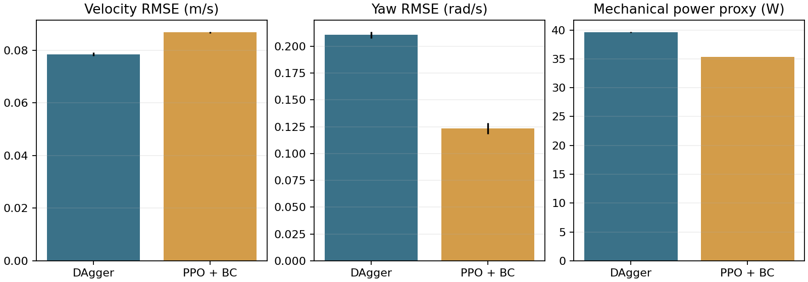

# Kết quả thực nghiệm trên máy 1660 Ti — 2026-11-11

Đã thực hiện toàn bộ chuỗi kiểm tra mô phỏng, học đứng, học đi, điều khiển, chống nhiễu, dốc và rough terrain. Các bài không đạt được giữ nguyên trong báo cáo.

## Nguồn policy và phạm vi

Policy sử dụng được hiện tại có nguồn **Unitree pretrained → imitation → DAgger → PPO + BC anchoring**. Không phải kết quả PPO tự học locomotion từ đầu. G1 có 29 khớp vật lý; policy xuất 29 action, 17 action thân trên được mask về 0, 12 khớp chân điều khiển chuyển động. Thân trên giữ bằng PD. Phase 0.8 s được cung cấp cho actor. Chỉ chạy trong MuJoCo.

Nguồn teacher: https://github.com/unitreerobotics/unitree_rl_gym tại commit `276801e46c5d433564f24658bac64f254b7d2d4b`. Policy/models upstream nằm trong `vendor/` không được commit.

## Máy và quá trình chạy

Ryzen 5 4600H, RAM 16 GB, GTX 1660 Ti Mobile 6 GB, Linux, Python 3.10, MuJoCo 3.3.7, PyTorch 2.6 CPU, SB3 2.7. Physics và PPO dùng CPU; EGL render xác nhận GPU NVIDIA 1660 Ti. GUI đã mở trực tiếp, tự chạy chu kỳ đứng–đi–quay nhẹ–dừng.

- Baseline PD và policy đứng: 3/3 episode đủ 30 s, seed 10000–10002.
- PPO đứng: 32,768 bước. Pilot đi chậm dừng sau 48,796 bước thu thập vì đứng tại chỗ.
- Pilot PPO thêm vận tốc thân và reward chặt hơn: 131,072 bước; vẫn ngã khi cố tiến lên.
- Imitation: 16,000 mẫu teacher trên mô hình G1 của dự án. MSE nhỏ chưa bảo đảm rollout ổn định.
- DAgger: 10 vòng × 2,048 mẫu, chọn round 7 từ validation seed 5000 trước đánh giá 30 s.
- PPO thuần fine-tune: 4 giai đoạn × 16,384 bước, đều bị guard loại do mất khả năng đi thẳng.
- PPO + BC: 4 giai đoạn × 8,192 bước, có warm-up critic 4,096 bước/giai đoạn; đều qua guard đi thẳng.
- Bổ sung DAgger cho dốc 2°: 8 vòng × 1,024 mẫu, checkpoint round 4 được kiểm tra riêng.

Guard chỉ đo đi thẳng 10 s trên seed 5000, không chứng nhận khả năng đi terrain hay mọi lệnh. Các run là thí nghiệm phát triển với nhiều cấu hình thay đổi, không phải so sánh thuật toán công bằng.

## Kết quả đi thẳng có ghép cặp

Lệnh 0.3 m/s, 30 s, cùng seed 20000–20002. Cả hai checkpoint sống sót 3/3.

Checkpoint PPO + BC tiến trung bình 6.21 m; 75 lần nhấc–đặt chân hợp lệ trong episode đầu. Vận tốc dao động theo chu kỳ bước, không phải trượt đứng yên.



Trong bộ test nhỏ này, PPO + BC giảm sai số quay và công suất cơ học proxy, nhưng sai số vận tốc tăng so với DAgger. Không kết luận cải thiện toàn diện. Error bar là SD qua episode, không phải CI qua seed train.

## Benchmark checkpoint PPO + BC

`runs/autonomous-1660/selected`, seed 20000–20002, mỗi bài 30 s. Forward/full-suite dùng 0.4 m/s; khác bài đi 0.3 m/s ở trên. Dốc 0.2/0.5 tương ứng 2°/5°; rough 0.2/0.5 tối đa 1.2/3 cm.

| Scenario | Không ngã / 3 | Thời gian (s) | RMSE vận tốc (m/s) | RMSE quay (rad/s) |
|---|---:|---:|---:|---:|
| stand | 3/3 | 30.0 | 0.054 | 0.082 |
| forward | 3/3 | 30.0 | 0.104 | 0.134 |
| lateral | 2/3 | 24.3 | 0.174 | 0.179 |
| turn | 0/3 | 7.5 | 0.340 | 0.469 |
| command_changes | 3/3 | 30.0 | 0.095 | 0.147 |
| friction_0.3 | 3/3 | 30.0 | 0.109 | 0.144 |
| friction_0.6 | 3/3 | 30.0 | 0.106 | 0.140 |
| friction_1.1 | 3/3 | 30.0 | 0.108 | 0.123 |
| mass_0.85 | 3/3 | 30.0 | 0.140 | 0.205 |
| mass_1.15 | 3/3 | 30.0 | 0.135 | 0.201 |
| slope_0.2 | 0/3 | 3.4 | 0.497 | 0.620 |
| slope_0.5 | 0/3 | 1.4 | 0.637 | 1.068 |
| rough_0.2 | 3/3 | 30.0 | 0.125 | 0.172 |
| rough_0.5 | 0/3 | 2.6 | 0.608 | 0.618 |
| stairs_0.2 | 0/3 | 2.1 | 0.533 | 0.917 |
| stairs_0.5 | 0/3 | 2.0 | 0.582 | 0.598 |
| push_2_front | 3/3 | 30.0 | 0.104 | 0.134 |
| push_2_side | 3/3 | 30.0 | 0.104 | 0.133 |
| push_5_front | 3/3 | 30.0 | 0.104 | 0.134 |
| push_5_side | 3/3 | 30.0 | 0.104 | 0.134 |
| push_10_front | 3/3 | 30.0 | 0.105 | 0.138 |
| push_10_side | 3/3 | 30.0 | 0.106 | 0.136 |

Lực đẩy áp vào pelvis theo +X/+Y thế giới tại giây thứ 5 trong 0.1 s; báo xung lực N·s. Không suy ra ngưỡng lực đẩy tối đa từ ba mức 2/5/10 đã thử.

## Checkpoint bổ sung cho dốc nhẹ

`runs/autonomous-1660/dagger-slope/round-4`, lệnh 0.3 m/s, seed 30000–30002, 30 s.

Dốc 2°:

| Scenario | Không ngã / 3 | Thời gian (s) | RMSE vận tốc (m/s) | RMSE quay (rad/s) |
|---|---:|---:|---:|---:|
| configured | 3/3 | 30.0 | 0.133 | 0.118 |

Kiểm tra lại sàn phẳng cùng checkpoint:

| Scenario | Không ngã / 3 | Thời gian (s) | RMSE vận tốc (m/s) | RMSE quay (rad/s) |
|---|---:|---:|---:|---:|
| configured | 3/3 | 30.0 | 0.086 | 0.126 |

### Benchmark mở rộng checkpoint có dốc

Đây là checkpoint khác bảng PPO + BC ở trên. Dùng full suite, seed 30000–30002, 30 s.

| Scenario | Không ngã / 3 | Thời gian (s) | RMSE vận tốc (m/s) | RMSE quay (rad/s) |
|---|---:|---:|---:|---:|
| stand | 3/3 | 30.0 | 0.051 | 0.082 |
| forward | 3/3 | 30.0 | 0.108 | 0.137 |
| lateral | 3/3 | 30.0 | 0.148 | 0.169 |
| turn | 3/3 | 30.0 | 0.056 | 0.157 |
| command_changes | 3/3 | 30.0 | 0.096 | 0.139 |
| friction_0.3 | 3/3 | 30.0 | 0.106 | 0.137 |
| friction_0.6 | 3/3 | 30.0 | 0.108 | 0.136 |
| friction_1.1 | 3/3 | 30.0 | 0.115 | 0.136 |
| mass_0.85 | 3/3 | 30.0 | 0.104 | 0.183 |
| mass_1.15 | 3/3 | 30.0 | 0.116 | 0.148 |
| slope_0.2 | 3/3 | 30.0 | 0.161 | 0.140 |
| slope_0.5 | 0/3 | 1.8 | 0.894 | 0.778 |
| rough_0.2 | 2/3 | 21.4 | 0.248 | 0.238 |
| rough_0.5 | 0/3 | 3.2 | 0.607 | 0.769 |
| stairs_0.2 | 0/3 | 4.3 | 0.510 | 0.435 |
| stairs_0.5 | 0/3 | 2.7 | 0.515 | 0.829 |
| push_2_front | 3/3 | 30.0 | 0.108 | 0.137 |
| push_2_side | 3/3 | 30.0 | 0.108 | 0.136 |
| push_5_front | 3/3 | 30.0 | 0.108 | 0.138 |
| push_5_side | 3/3 | 30.0 | 0.108 | 0.138 |
| push_10_front | 3/3 | 30.0 | 0.109 | 0.139 |
| push_10_side | 3/3 | 30.0 | 0.119 | 0.146 |

### Phục hồi đo lại bằng schema đã sửa

Đẩy ngang 10 N·s trên checkpoint terrain: 3/3 lần có phục hồi đo được, trung bình 1.43 s sau khi xung lực kết thúc. Điều kiện: sai số vận tốc <0.15 m/s và upright vật lý >0.9 liên tục ít nhất 0.5 s. Xem `experiment-data/recovery-verified/episodes.csv`.

## Sửa lỗi chỉ số tư thế

Trong log đầu chiến dịch, key `upright` bị reward cùng tên ghi đè thành 0.5 × giá trị tư thế thật. Đã sửa code để reward dùng tiền tố `reward_` và thêm kiểm thử. Dynamics, reward tổng, survival, vận tốc và năng lượng không bị đổi. Biểu đồ cũ dựng lại upright vật lý bằng 2 × giá trị log; raw CSV giữ nguyên. `recovery_time_s` trong episode CSV cũ không dùng để kết luận. Bài `recovery-verified` được chạy lại bằng schema đã sửa.

## Giới hạn và cách xem lại

- Chỉ một seed huấn luyện chính (42); ba seed đánh giá chủ yếu thay đổi tư thế ban đầu và rough map. Chưa có kết luận thống kê qua nhiều policy train độc lập.
- Bộ seed 10000+ đã dùng khi phát triển; seed 20000+ và 30000+ dùng sau chọn checkpoint tương ứng.
- Đi ngang, quay tại chỗ, dốc lớn và cầu thang phải xem tỷ lệ thất bại trong bảng; không được coi mọi năng lực đã đạt chỉ vì demo đi thẳng thành công.
- Công suất là proxy cơ học từ actuator, không phải điện năng tiêu thụ robot hay GPU.
- Terrain scan là hình học chính xác từ simulator. Không có camera perception, AMP hay robot thật.
- Kiểm thử code: 14 pytest đạt, ruff đạt; GUI được mở và trạng thái mô phỏng được theo dõi qua log. Phiên computer-use không cung cấp quan sát cửa sổ native, nên kiểm tra hình ảnh dùng render/video.

```bash
source .venv/bin/activate
g1lab demo --bundle runs/autonomous-1660/selected-terrain --auto
g1lab demo --bundle runs/autonomous-1660/selected --terrain rough --difficulty 0.2 --auto
g1lab demo --bundle runs/autonomous-1660/selected-terrain --terrain slope --difficulty 0.2 --auto
```

Video local: `artifacts/autonomous-1660/final-video/configured-20000.mp4` và `artifacts/autonomous-1660/slope-video/configured-30000.mp4`. Raw trajectory CSV, log và checkpoint giữ tại máy. Các summary/protocol/episode CSV nhỏ được lưu ở [experiment-data](experiment-data/). SHA256 checkpoint nằm trong `experiment-data/checkpoint-sha256.json`. Các run được thực hiện trong working tree phát triển; metadata git_revision cũ không tự mô tả mọi thay đổi chưa commit lúc đó.
