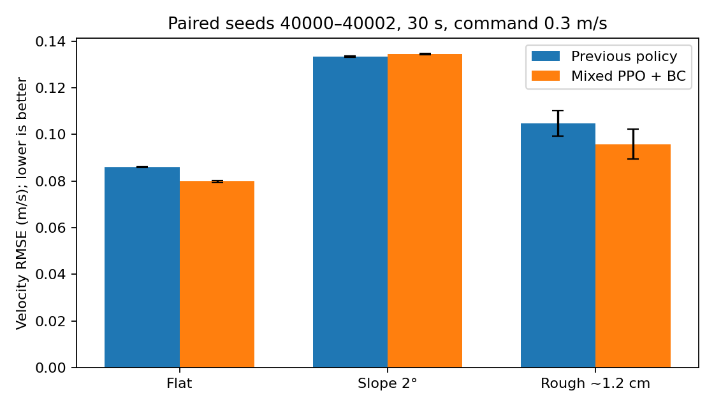

# Mixed-terrain local pilot — 1660 Ti machine

One training trajectory, initialized from the previous Unitree-teacher/DAgger/PPO+BC policy. This is an interleaved PPO + BC pilot, not from-scratch locomotion or a multi-seed algorithm comparison.

Trained 55,296 additional PPO transitions. Measured throughput: 511–539 transitions/s. CPU physics and network, GPU rendering.

## Held-out terrain test

Same seeds 40000–40002, 30 s each, command 0.3 m/s. Mean RMSE; survival shown as completed episodes. Error bars show episode standard deviation, not confidence over independent training runs.

| Terrain | Previous survival | Mixed survival | Previous RMSE | Mixed RMSE |
|---|---:|---:|---:|---:|
| flat | 3/3 | 3/3 | 0.0861 | 0.0798 |
| slope | 3/3 | 3/3 | 0.1334 | 0.1344 |
| rough | 3/3 | 3/3 | 0.1047 | 0.0958 |

## Broader regression audit

The following suite uses identical seeds 41000–41002 and 30 s episodes. Forward command is 0.4 m/s here, unlike the 0.3 m/s terrain test. These data were measured after checkpoint selection.

| Scenario | Previous survival | Mixed survival | Previous velocity RMSE | Mixed velocity RMSE |
|---|---:|---:|---:|---:|
| stand | 3/3 | 3/3 | 0.052 | 0.050 |
| forward | 3/3 | 3/3 | 0.108 | 0.100 |
| lateral | 3/3 | 3/3 | 0.150 | 0.123 |
| turn | 3/3 | 0/3 | 0.060 | 0.337 |
| command_changes | 3/3 | 3/3 | 0.096 | 0.090 |
| friction_0.3 | 3/3 | 3/3 | 0.106 | 0.097 |
| friction_0.6 | 3/3 | 3/3 | 0.108 | 0.100 |
| friction_1.1 | 3/3 | 3/3 | 0.115 | 0.106 |
| mass_0.85 | 3/3 | 3/3 | 0.104 | 0.095 |
| mass_1.15 | 3/3 | 3/3 | 0.116 | 0.097 |
| slope_0.2 | 3/3 | 3/3 | 0.162 | 0.167 |
| slope_0.5 | 0/3 | 0/3 | 0.888 | 0.879 |
| rough_0.2 | 2/3 | 3/3 | 0.226 | 0.106 |
| rough_0.5 | 1/3 | 1/3 | 0.350 | 0.278 |
| stairs_0.2 | 0/3 | 0/3 | 0.524 | 0.463 |
| stairs_0.5 | 0/3 | 0/3 | 0.602 | 0.492 |
| push_2_front | 3/3 | 3/3 | 0.108 | 0.099 |
| push_2_side | 3/3 | 3/3 | 0.108 | 0.100 |
| push_5_front | 3/3 | 3/3 | 0.108 | 0.099 |
| push_5_side | 3/3 | 3/3 | 0.108 | 0.100 |
| push_10_front | 3/3 | 3/3 | 0.109 | 0.101 |
| push_10_side | 3/3 | 3/3 | 0.119 | 0.106 |

## Interpretation and reproduction

Selection used seeds 6000–6001 only; two candidate rounds were accepted and the third rejected. The terrain-selected candidate is `runs/mixed-1660-v1/selected`. The broader audit found loss of in-place turning (0/3 completions versus 3/3 for the previous policy), so it is NOT promoted to the default demonstration. This is a negative result for the narrow selection gate. The previous bundle is retained. No model is certified for arbitrary terrain; three test episodes cannot establish reliability. Improvements on a single task do not imply improvements on other commands or terrain levels.

See [local training protocol](LOCAL_TRAINING.md) for the command, selection heuristic, teacher provenance, data dependencies, and criteria for moving to a larger machine.
