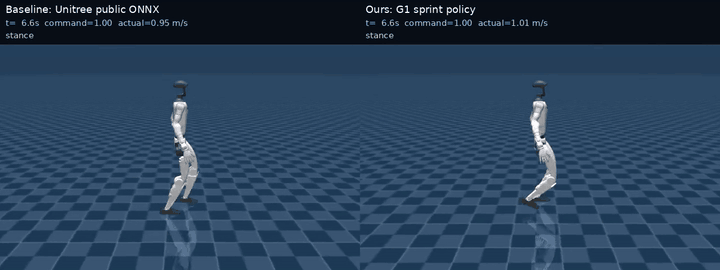

# G1 Sprint — Báo cáo dự án

Cập nhật: 17/11/2026
Robot: Unitree G1 29 khớp (chỉ mô phỏng)
Train: Isaac Sim 5.1 / Isaac Lab 2.3.2 (PhysX), RSL-RL PPO, 4096 môi trường song song, RTX 5090
Chấm điểm: MuJoCo 3.3.7 — simulator độc lập, seed mới, cùng giới hạn động cơ
Mục tiêu: chạy bứt tốc có pha bay, giữ thăng bằng, giảm tốc và dừng, không vượt thông số động cơ

---

## 1. Kết quả nổi bật

| | Baseline (ONNX công khai của Unitree) | **Policy sprint của dự án** |
|---|---|---|
| Tốc độ cao nhất đạt 10/10 seed, giữ 60 s (MuJoCo) | 1,0 m/s (ở 1,5 m/s không ngã nhưng thân xoay 0,29 rad/s, trượt tiêu chí) | **lệnh 5,5 m/s → thực 4,94 m/s** |
| Ở lệnh 2,0 m/s | ngã cả 10/10 seed sau ~6 s | 2,08 m/s, 10/10 |
| Dáng | đi bộ, 0 % pha bay | **chạy, pha bay 46 %**, chạm đất 0,13 s |
| Giảm tốc và dừng | có (≤ 1,5 m/s) | có, ở mọi mức tới 5,5 m/s (tốc độ cuối ≈ 0,003 m/s) |
| Tốc độ khớp cao nhất / định mức | — | 72 % |

Cả hai policy được chấm bằng cùng một bài MuJoCo, cùng mô hình động cơ (đỉnh mô-men theo MuJoCo + đường cong
mô-men–tốc độ N7520), 10 seed chưa từng dùng khi train.



Video demo (MuJoCo, cùng seed; đi 1 m/s trong 5 s → tăng tốc → giữ 8 s → giảm tốc → dừng):
[1 → 3,5 m/s](media/demo-cruise-to-3.5mps.mp4) · [1 → 5,5 m/s](media/demo-cruise-to-5.5mps.mp4).
Baseline ngã ở giây 9,4 trong cả hai video (khi lệnh tăng qua ~2,8 m/s); policy dự án giữ 3,44 và 4,94 m/s,
pha bay 41–42 %, rồi dừng.

Thang tốc độ (bắt đầu từ đứng yên):

| Lệnh | Baseline | Dự án (tốc độ thật khi giữ, pha bay) |
|---|---|---|
| 1,5 m/s | 1,49 m/s, đi bộ | 1,55 m/s, 2 % |
| 3,0 m/s | ngã ở giây 5,1 | 3,02 m/s, 38 % |
| 4,0 m/s | ngã ở giây 4,6 | 3,84 m/s, 41 % |
| 5,5 m/s | ngã ở giây 4,1 | 4,94 m/s, 42 % (một seed video) |

Policy: [models/g1-sprint-v2-r11/](../models/g1-sprint-v2-r11/) (ONNX + deploy.yaml + checkpoint RSL-RL).
Số liệu: [experiment-data/sprint-v2/](experiment-data/sprint-v2/).

**Chưa đạt so với yêu cầu:** tiếp đất bằng gót 100 % (yêu cầu: mũi chân); hai tay giơ ra trước thay vì đánh
tay; dáng còn khuỵu; nhịp bước gần như không tăng theo tốc độ (3,9 → 4,1 bước/s), tốc độ tăng chủ yếu nhờ
sải dài. 11 m/s là trần nghiên cứu, không phải cam kết; bài báo SPRINT (arXiv 2605.28549) công bố khoảng 6 m/s
trên G1.

---

## 2. Kiến trúc hệ thống

```text
                       G1 SPRINT — TRAIN TRONG ISAAC, CHẤM TRONG MUJOCO

┌──────────────────────── GPU1 (RTX 5090), không mạng ────────────────────────┐
│                                                                             │
│  Isaac Sim 5.1 / Isaac Lab 2.3.2 (PhysX, dt 5 ms, điều khiển 50 Hz)          │
│  Task Unitree-G1-29dof-Sprint-G1Lab × 4096 robot                             │
│    ├─ Lệnh tốc độ có giới hạn gia tốc (tăng 2, giảm 2,5 m/s²) + giữ hướng     │
│    ├─ Theo dõi pha bước (cảm biến bàn chân 20 N, khử nhiễu 40 ms)            │
│    ├─ Reward: 19 term gốc Unitree (có cổng tốc độ) + 20 term chạy nước rút   │
│    ├─ Động cơ theo thông số (đỉnh MuJoCo + đường cong N7520, trễ 0–20 ms)    │
│    └─ Domain randomization (ma sát, khối lượng, trọng tâm, gain, armature)   │
│                     │                                                       │
│  RSL-RL PPO: actor MLP 480→512→256→128→29 (ELU), critic 495→…→1              │
│  24 bước × 4096 env = 98 304 bước/iteration, ~27 000 bước/s                  │
└─────────────────────┬───────────────────────────────────────────────────────┘
                      │ checkpoint mỗi vòng (600 iteration ≈ 26 phút)
                      ▼
┌──────────────────────────── AUTOPILOT (stdlib) ─────────────────────────────┐
│ train → thang tốc độ Isaac (2 seed × 32 robot) → export ONNX                 │
│       → MuJoCo nhanh (nền, CPU) → bản tốt nhất mới → MuJoCo 10 seed × 60 s   │
│ Tự xử lý: rollback khi tụt tốc/NaN, curriculum, nút chỉnh, chặn lỗi lặp      │
│ An toàn: canh GPU0, unshare -rn, SIGKILL cả nhóm tiến trình, dừng khi đầy đĩa │
└─────────────────────┬───────────────────────────────────────────────────────┘
                      ▼
┌──────────────────────── MUJOCO (CPU, độc lập) ──────────────────────────────┐
│ Đứng → tăng tốc → giữ 60 s → giảm tốc → dừng, 10 seed mới                    │
│ Cùng giới hạn mô-men/tốc độ khớp; đo pha bay, chạm đất, cadence, gót/mũi …   │
└─────────────────────┬───────────────────────────────────────────────────────┘
                      ▼
         dashboard.html (offline) · REPORT.md · video so sánh (EGL, GPU1)
```

Nguyên tắc: **Isaac để train, MuJoCo để kết luận.** Hai simulator không được giả định cho cùng kết quả; mọi số
liệu ghi rõ simulator. Giới hạn mô-men, tốc độ khớp, gain PD và mô hình robot không được nới để làm đẹp kết quả.

---

## 3. Hạ tầng, công cụ và phần mềm

### 3.1 Phần mềm

| Thành phần | Phiên bản | Ghi chú |
|---|---|---|
| Isaac Sim | 5.1.0 (pip) | |
| Isaac Lab | v2.3.2 (37ddf62) | cài từ source |
| PyTorch | 2.7.0 + cu128 | bản đầu tiên hỗ trợ sm_120 (RTX 5090) |
| RSL-RL | 3.1.2 | PPO |
| unitree_rl_lab | 4960b84 (ghim) | task velocity G1, ONNX v0 |
| unitree_mujoco | 1eb6642 (ghim) | mô hình `g1_29dof.xml` |
| MuJoCo | 3.3.7 | chấm điểm, render EGL |
| onnxruntime | 1.22 | chạy policy trong MuJoCo |

Hai môi trường Python tách biệt: `.venv-eval` (3.10, Torch CPU cố ý, MuJoCo) và `envs/isaac51` (3.11, CUDA).
Mọi lệnh cài vào môi trường Isaac đều kèm file constraints, vì `isaaclab.sh --install` dùng `uv` và tự nâng
Torch lên bản CUDA 13. Chi tiết: [RTX_5090_BRINGUP.md](RTX_5090_BRINGUP.md).

### 3.2 Chỉ dùng một GPU

Máy có hai GPU, GPU0 dành cho việc khác. [gpu.py](../src/g1lab/gpu.py):
- CUDA ghim theo **UUID** GPU1 + `CUDA_DEVICE_ORDER=PCI_BUS_ID`; từ chối mọi `CUDA_VISIBLE_DEVICES` khác.
- Render MuJoCo/EGL chọn thiết bị theo địa chỉ PCI (extension `EGL_NV_device_cuda`).
- Kit chạy với multi-GPU tắt, `activeGpu=1`.
- Autopilot có luồng canh: tiến trình của dự án xuất hiện trên GPU0 → dừng toàn bộ.

### 3.3 Chạy không cần mạng

Isaac mặc định tải mặt đất "plane", sky HDR, MDL và mũi tên lệnh từ cloud NVIDIA. Task Sprint thay bằng mặt
đất sinh tại chỗ (3 × 3 ô 250 m, viền 50 m — đủ 20 s ở 11 m/s), tắt sky và debug marker. Mọi tiến trình con của
autopilot chạy trong `unshare -rn` (không có mạng), nên train qua đêm khi tắt mạng.

### 3.4 Công cụ do dự án viết

| Công cụ | Vai trò |
|---|---|
| [autopilot_sprint.py](../scripts/autopilot_sprint.py) | Vòng lặp train → đánh giá → giữ bản tốt nhất → tự xử lý, không người trông |
| [autopilot_dashboard.py](../scripts/autopilot_dashboard.py) | Trang HTML offline + chế độ terminal theo dõi lượt train |
| [isaac_sprint_eval.py](../scripts/isaac_sprint_eval.py) | Thang tốc độ trong Isaac, nhiều tốc độ trong một tiến trình |
| [mujoco_sprint_eval.py](../scripts/mujoco_sprint_eval.py) | Thang tốc độ MuJoCo song song (ProcessPool) + số đo dáng chạy |
| [render_compare.py](../scripts/render_compare.py) | Video MuJoCo hai policy cạnh nhau, cùng seed |
| [isaac_sprint_probe.py](../scripts/isaac_sprint_probe.py) | Kiểm tra dấu/độ lớn từng term reward trên một policy |
| [onnx_to_rslrl.py](../scripts/onnx_to_rslrl.py) / [export_rslrl_onnx.py](../scripts/export_rslrl_onnx.py) | ONNX ↔ checkpoint RSL-RL |
| [prepare_lab_fast.py](../scripts/prepare_lab_fast.py) / [isaac_train.py](../scripts/isaac_train.py) | Launcher train + provenance, critic warm-up |

---

## 4. Thiết kế phần thưởng

Task Sprint ([isaac_sprint.py](../src/g1lab/isaac_sprint.py)) giữ nguyên quan sát và action của task velocity
Unitree (480 → 29), nên actor ONNX gốc ghép thẳng vào được, nhưng thay đổi reward khá nhiều.

### 4.1 Vì sao reward baseline không cho chạy

Reward gốc của Unitree được thiết kế cho **đi bộ ổn định ~1 m/s**:

| Term gốc | Ép điều gì | Xung đột với chạy |
|---|---|---|
| `gait` (chu kỳ 0,8 s, mỗi chân chạm đất 55 %) | luôn có chân dưới đất | chạy cần pha bay |
| `base_height` (0,78 m, −10) | thân cao cố định | chạy có dao động thân |
| `base_linear_velocity` (vz², −2) | thân không nảy | mỗi bước chạy là một cú bật |
| `flat_orientation` (−5) | thân thẳng đứng | tăng tốc cần đổ người |
| `joint_deviation_arms` (−0,1) | tay đứng yên | chạy cần đánh tay |
| `track_lin_vel_xy` (σ cố định 0,5 m/s) | | ở 8 m/s, sai 5 % đã gần như mất thưởng |

### 4.2 Bám tốc độ có dung sai theo tốc độ

`track_lin_vel_xy` = exp(−|v_lệnh − v|² / σ²) với σ = max(0,5; 0,15·|v_lệnh|), trọng số 1,5 (gốc 1,0). Giữ
đúng "slot" mà curriculum của Unitree đọc để mở dải tốc độ.

### 4.3 Cổng đi bộ ↔ chạy

s = clip((v_lệnh − 1,6) / 0,6; 0; 1). Năm term đi bộ ở trên nhân (1 − s): dưới 1,6 m/s reward giống hệt task mà
ONNX được train (robot vẫn đi bộ như baseline), trên 2,2 m/s chúng tắt hẳn và các term chạy (nhân s) bật lên.

### 4.4 Các term chạy nước rút (mới)

| Yêu cầu kỹ thuật chạy | Term (trọng số) | Cách tính |
|---|---|---|
| Pha bay dài | `flight_phase` (+0,5), `double_support` (−1) | thưởng khi cả hai chân trên không; phạt hai chân cùng chạm |
| Chạm đất cực ngắn | `stance_too_long` (−10) | phạt khi thời gian chạm > 0,36 − 0,04·v (≥ 0,12 s) |
| Nhịp bước theo tốc độ | `cadence_tracking` (+2) | mỗi lần chạm đất luân phiên: exp(−((f − f*)/0,6)²), f* = clip(3 + 0,3v; 3,2; 5) bước/s; nhảy hai chân = 0 |
| Lực đẩy ngang cực đại | `accel_push_off` (+1), `cruise_braking` (−0,5) | lực ngang = Σ mᵢaᵢ (cảm biến Isaac chỉ cho lực pháp tuyến), đơn vị trọng lượng; thưởng đẩy khi tăng tốc, phạt hãm khi chạy đều |
| Tiếp đất mũi chân | `midfoot_landing` (+0,5) | lúc chạm: mũi thấp hơn gót +1, phẳng ≈ +0,3, gót trước −1 |
| Đặt chân dưới thân | `overstride` (−1), `landing_foot_speed` (−1) | phạt chạm đất > 15 cm trước trọng tâm và chân còn trượt khi chạm |
| Nâng cao đầu gối | `knee_lift` (+0,5) | chân vung: gối từ 0,44 m dưới hông (đứng) tới 0,24 m |
| Gập cổ chân | `swing_dorsiflexion` (+0,3) | mũi chân hướng lên khi bàn chân vung cao > 8 cm |
| Đánh tay, không xoắn thân | `low_twist` (+0,5) | exp(−(L_z/m/0,02)²): mô-men động lượng toàn thân quanh trục đứng nhỏ ⇒ tay phải đánh ngược chân; vai trước–sau để tự do |
| Đổ người theo giai đoạn | `acceleration_lean` (−20) | góc ngả mục tiêu atan(a/g) + 4°, dải chết 3° |
| Chạy thẳng | `run_yaw_tracking` (+2), `torso_roll` (−5), `wide_step` (−1) | |
| Không vượt thông số | `joint_speed_margin` (−2), `torque_clipping` (−1) | phạt khớp > 90 % tốc độ định mức, phạt đòi mô-men vượt giới hạn |
| Ngã | `termination` (−200) | |

Pha bước không dùng đồng hồ pha: `GaitTracker` đọc cảm biến bàn chân ở mọi bước vật lý (ngưỡng 20 N, khử nhiễu
40 ms — cùng quy ước với MuJoCo) và ghi lại chạm đất, nhấc chân, thời gian chạm/bay, độ cao mũi–gót, vị trí
đặt chân.

### 4.5 Tiến hoá của reward và lý do

| Phiên bản | Thay đổi | Lý do (quan sát thực tế) |
|---|---|---|
| v1 | Phạt bình phương sai lệch quay | Policy học **ngã sớm** để khỏi bị phạt: độ dài tập 618 → 58 bước |
| v2 | Mọi "nên làm" là thưởng có chặn (exp), ngã −200, động cơ theo thông số, DR | Ngã luôn là lựa chọn tệ nhất. Train từ đầu đạt 5,5 m/s (lệnh) sau 11 vòng |
| v3 | Thưởng dáng chạy dương × chất lượng bám tốc độ (`_earned`); phạt không đổi | Vòng 18–30 của v2: policy **bỏ lệnh nhanh**, chạy thẳng ~2 m/s vì các thưởng dáng chạy chỉ xét tốc độ *lệnh* nên vẫn trả đủ khi chạy chậm (xem 7.1) |

Thử reward v3 trên hai policy cũ ở lệnh 5 m/s (Isaac, 32 robot): policy chạy nhanh (vòng 11, thực 4,69 m/s) nhận
5,48/bước, policy "lách" (vòng 30, thực 0,13 m/s) chỉ 2,19/bước — với v2 hai con số này gần nhau.
Số liệu: [reward_v3_probe_*.json](experiment-data/sprint-v2/).

---

## 5. Động cơ và domain randomization

### 5.1 Một mô hình động cơ cho cả hai simulator

[actuator_spec.py](../src/g1lab/actuator_spec.py), theo lựa chọn của chủ dự án: **đỉnh mô-men lấy từ
`ctrlrange` của mô hình MuJoCo Unitree**, cộng dữ liệu đo động cơ của Unitree cho phần tốc độ.

| Khớp | Đỉnh mô-men | Động cơ | Giảm mô-men theo tốc độ |
|---|---|---|---|
| hông pitch/yaw, eo yaw | 88 N·m | N7520-14.3 | đủ mô-men tới 22,6 rad/s, giảm tuyến tính về 0 ở 35,5 rad/s; ma sát |
| hông roll | 88 N·m | N7520-22.5 | tới 14,5 rad/s, về 0 ở 22,7 rad/s; ma sát |
| gối | 139 N·m | N7520-22.5 | như trên |
| cổ chân, eo roll/pitch | 50 N·m | N5020-16 | phẳng, 37 rad/s |
| vai, khuỷu, cổ tay roll | 25 N·m | N5020-16 | phẳng, 37 rad/s |
| cổ tay pitch/yaw | 5 N·m | W4010-25 | phẳng, 22 rad/s |

Isaac: động cơ chân dùng `UnitreeActuatorCfg` (PD có trễ), khớp khác implicit. MuJoCo: cùng hàm `clip_torque`;
một lượt chấm **trượt** nếu bất kỳ khớp nào vượt tốc độ định mức. Lượt train đầu tiên (13–16/11) dùng động cơ
mạnh hơn thông số (88/139 N·m phẳng, không đường cong); kết quả đó đã bị loại.

### 5.2 Domain randomization

| Nhóm | Phạm vi |
|---|---|
| Ma sát mặt đất | 0,3–1,0 |
| Khối lượng mọi khâu | ×0,9–1,1 |
| Khối lượng thân | +[−1; 3] kg |
| Trọng tâm thân | ±3 cm (x, z), ±2 cm (y) |
| Gain PD | kp ×0,9–1,1, kd ×0,8–1,2 |
| Armature khớp | ×0,8–1,2 |
| Trễ lệnh động cơ chân | 0–20 ms |
| Đẩy ngẫu nhiên | mỗi 3–7 s, ±0,5 m/s (x, y), ±0,3 rad/s (yaw) |
| Nhiễu quan sát | theo task gốc Unitree |

Chấm MuJoCo dùng điều kiện danh định (không đẩy, không DR); khác biệt PhysX ↔ MuJoCo chính là phép thử chuyển
simulator.

---

## 6. Quy trình train và đánh giá

### 6.1 Khởi tạo

ONNX v0 công khai của Unitree **chính là** actor RSL-RL (480→512→256→128→29, ELU), nên được ghép chính xác vào
checkpoint ([onnx_to_rslrl.py](../scripts/onnx_to_rslrl.py)) rồi warm-up critic với actor đóng băng. Phát hiện
khi bring-up: actor này chỉ đi được trong PhysX với gain PD của `deploy.yaml` v0 (eo roll/pitch kp 200, tay kd 10),
khác robot config của revision Unitree đang ghim (40 và 1) — dự án đăng ký task `…-G1LabV0Gains` riêng, không sửa
vendor. Lượt train hiện tại (v2) đi **từ đầu** (khởi tạo ngẫu nhiên) với động cơ theo thông số.

### 6.2 PPO

Cấu hình RSL-RL của Unitree: clip 0,2, entropy 0,01, 5 epoch × 4 minibatch, γ 0,99, λ 0,95, LR thích nghi theo
KL 0,01 (khởi đầu 1e-3), 24 bước/env/iteration. Tập dài 20 s; lệnh đổi sau 4–8 s, 10 % robot được lệnh đứng yên.

### 6.3 Autopilot

Mỗi vòng 600 iteration (~26 phút, ~59 triệu bước mô phỏng):
1. Train tiếp từ checkpoint hiện tại, mang theo mức curriculum.
2. Thang tốc độ Isaac: 2 seed × 32 robot mỗi mức, lấy kết quả **kém hơn**; giữ 10 s; đạt khi ≥ 90 % sống,
   vx ≥ 85 % lệnh, quay < 0,25 rad/s, lệch hướng < 30°. Ghi thêm "chỉ xét tốc độ".
3. Export ONNX → MuJoCo nhanh chạy nền (CPU).
4. Bản tốt nhất mới → MuJoCo 10 seed mới × 60 s.
5. Tự xử lý (bản hiện tại):
   - mốc rollback = policy nhanh nhất **đã kiểm chứng MuJoCo** (kể cả policy khởi tạo);
   - tốc độ "chỉ xét tốc độ" tụt ≥ 1,5 m/s hai vòng liền, hoặc về 0 → rollback, LR × 0,5;
   - NaN hoặc std hành động âm → không bao giờ train tiếp từ checkpoint đó;
   - chững 3 vòng → nút chỉnh kế tiếp (không bao giờ tăng thưởng giữ hướng);
   - lỗi khởi động (Hydra từ chối khoá) → gỡ nút chỉnh gây lỗi; lỗi lặp → chờ tăng dần, dừng sau 5 lần;
   - curriculum tự nâng 0,5 m/s khi policy đã giữ được tốc độ gần đỉnh dải.
6. An toàn: canh GPU0, `unshare -rn`, SIGTERM rồi SIGKILL cả nhóm tiến trình, dừng khi đĩa < 50 GB,
   `control.json` để dừng/đặt hạn.

Theo dõi offline: `artifacts/<run>/dashboard.html` (tự làm mới mỗi phút) hoặc
`python3 scripts/autopilot_dashboard.py --run <run> --terminal --watch 60`.

### 6.4 Tiêu chí MuJoCo (kết luận)

Đứng → tăng tốc 2 m/s² → giữ 60 s → giảm tốc → dừng. Đạt khi: không ngã; vx ≥ 85 % lệnh; RMSE vận tốc phẳng
≤ max(0,15; 20 % lệnh); RMS quay < 0,25 rad/s; lệch hướng < 30°; tốc độ cuối < 0,15 m/s; mọi khớp ≤ tốc độ định
mức. Số đo dáng chạy ở 500 Hz, ngưỡng 20 N, khử nhiễu 40 ms.

---

## 7. Diễn biến thực nghiệm

### 7.1 Lượt v2 từ đầu (16–17/11)

Kết quả MuJoCo ở bảng dưới là bài 10 seed × 60 s của policy vòng đó (chạy nền sau vòng train).

| Vòng | Kết thúc train | Sự kiện |
|---|---|---|
| 1 | 11:41 | bắt đầu 11:12 từ khởi tạo ngẫu nhiên, dải lệnh 0–1 m/s |
| 4 | 13:02 | MuJoCo 2,0 m/s |
| 7 | 14:25 | MuJoCo 10 seed: 3,5 m/s (thực 3,31), pha bay 36 % |
| 8 | 14:58 | MuJoCo 10 seed: 4,0 m/s |
| 10 | 16:25 | MuJoCo 10 seed: 5,0 m/s |
| **11** | **17:12** | **MuJoCo 10 seed: 5,5 m/s (thực 4,94) — tốt nhất** |
| 15 | 20:28 | Isaac chỉ xét tốc độ 7,0 m/s (quay 0,51 rad/s, không đạt MuJoCo) |
| 18–30 | 22:05–04:18 | **sụp tốc độ**: Isaac vx lớn nhất 5,36 → 2,03 m/s |
| 31–2344 | 04:19–08:12 | **lặp lỗi khởi động** (xem 7.2) |

Tới vòng 11: ~6 giờ, 6 589 iteration ≈ 650 triệu bước mô phỏng (~150 ngày kinh nghiệm). Bảng từng vòng:
[v2_rounds.csv](experiment-data/sprint-v2/v2_rounds.csv).

**Sụp tốc độ (vòng 18–30).** Nút chỉnh `yaw_tracking_1.0` nhân đôi thưởng quay; trong khi đó các thưởng dáng chạy
(giữ hướng, xoắn thấp, nâng gối …) chỉ xét tốc độ *lệnh*, nên vẫn trả đủ khi robot chạy chậm hơn lệnh. Reward
train **tăng** 42 → 53 trong khi tốc độ **giảm**: thưởng bám tốc độ 1,12 → 0,41, thưởng quay 0,79 → 1,56. Tiêu
chí Isaac "đủ tiêu chí" có xét quay nên coi policy chậm–thẳng là tốt hơn và không rollback. Sửa: reward v3,
rollback theo tốc độ "chỉ xét tốc độ", mốc rollback là policy đã kiểm chứng MuJoCo, bỏ nút tăng thưởng quay.

### 7.2 Sự cố vận hành và cách sửa

| Sự cố | Hậu quả | Sửa |
|---|---|---|
| Nút chỉnh dùng khoá reward v1 (`swing_air_time`) đã xoá | Isaac thoát sau 6 s, 2 314 lần thử lại trong 4 giờ | Lỗi khởi động ⇒ gỡ nút chỉnh, chờ tăng dần, dừng sau 5 lần; test khoá reward của mọi nút chỉnh |
| Rollback về bản "tốt nhất" Isaac khi bản đó đã ở giữa đợt sụp | Không thoát được đợt sụp | Mốc = policy đã kiểm chứng MuJoCo |
| Lượt v3 (17/11) sụp ngay vòng 1 (ngã 2 % → 98 %), autopilot lấy bản 0 m/s làm mốc, hạ curriculum về 0,5 m/s | Mất ~2,5 giờ | Policy khởi tạo đã kiểm chứng là mốc (`--init-validated-speed`); về 0 m/s ⇒ rollback ngay; std âm = phân kỳ. Nguyên nhân sụp: quy trình fine-tune (warm-up/lr), không phải reward v3 — xem mục 9 |
| Lượt đầu (13–16/11) lặp rollback ~2 ngày, một tiến trình Isaac bỏ qua SIGTERM chạy mồ côi 15 giờ | | Cooldown rollback, SIGKILL cả nhóm |
| Isaac `train.py` bỏ qua `--experiment_name` | resume sai checkpoint | Hydra override `agent.experiment_name` |
| Cảm biến tiếp xúc chỉ cho lực pháp tuyến | không đo được lực đẩy ngang | Σ mᵢaᵢ |
| Tiếp xúc nhấp nháy (Isaac và MuJoCo) | đếm sai bước | ngưỡng 20 N + khử nhiễu 40 ms |
| `deploy.yaml` export có `!!python/tuple` | MuJoCo không đọc được | `sanitized_deploy` |

---

## 8. Đóng góp của dự án

1. **Bring-up RTX 5090 / sm_120**: tổ hợp Isaac Sim 5.1 pip + Isaac Lab 2.3.2 + Torch 2.7 cu128 chạy ổn định,
   có constraints chống tự nâng cấp; tái hiện baseline cũ chính xác tới 1e-15.
2. **Cô lập GPU và chạy offline**: CUDA theo UUID, EGL theo PCI, Kit một GPU; mặt đất cục bộ; mọi tiến trình
   con không mạng.
3. **Task Sprint**: lệnh tốc độ có gia tốc thật (tăng tốc, giữ, giảm tốc, dừng), theo dõi pha bước bằng cảm
   biến, 20 term reward kỹ thuật chạy, cổng đi bộ ↔ chạy, cơ chế `_earned` chống "lách" reward.
4. **Một mô hình động cơ cho hai simulator** và domain randomization rộng hơn task gốc.
5. **Đánh giá hai simulator**: thang tốc độ Isaac nhanh, MuJoCo độc lập với seed mới, kiểm tra thông số động
   cơ và 20+ số đo dáng chạy.
6. **Autopilot + dashboard + video so sánh**: train không người trông qua đêm, tự phát hiện và xử lý các kiểu
   hỏng đã gặp, theo dõi offline.
7. **Kết quả**: từ 1,0 m/s (baseline, cùng bài chấm) lên **4,94 m/s thực** có pha bay 46 %, 10/10 seed × 60 s,
   trong thông số động cơ.

---

## 9. Hạn chế

1. **Tiếp đất gót 100 %**: `midfoot_landing` (+0,5) quá yếu so với các term khác.
2. **Không đánh tay**: hai tay giơ ra trước (xem video); `low_twist` chưa đủ để ép đánh tay chủ động.
3. **Dáng khuỵu, nhịp bước không tăng**: tốc độ tăng nhờ sải dài; cadence 3,9 → 4,1 bước/s.
4. **Còn thưởng gốc không gắn với tốc độ**: `feet_clearance` (+1) và `track_ang_vel_z` (+0,5) của Unitree trả đủ
   cả khi dậm chân tại chỗ (policy vòng 30 nhận 1,6/bước từ `feet_clearance`).
5. **Fine-tune từ vòng 11 chưa ổn định**: lượt v3 sụp trong 250 iteration đầu. Thí nghiệm A/B (cùng
   checkpoint, cùng lr 5e-4 + critic warm-up 20 iteration, chỉ khác reward) cho thấy **reward v2 cũng sụp
   như v3** (ngã 1–3 % → 54–56 % sau 150 iteration, std hành động 0,62 → 0,76), nên nguyên nhân là quy trình
   fine-tune chứ không phải reward v3. Vòng 12 của lượt v2 (lr 1e-3, không warm-up) từ cùng checkpoint thì ổn
   định (ngã ~1 %). Đang xác nhận bằng thí nghiệm C/D (lr 1e-3, không warm-up; reward v2 và v3).
6. **Chỉ mô-men đỉnh**: chưa mô hình mô-men liên tục, nhiệt động cơ, công suất pin; giữ 60 s gần đỉnh mô-men
   có thể quá nhiệt trên robot thật.
7. **MuJoCo danh định**: chưa chấm có đẩy, DR, mặt đất trơn; chưa có thử nghiệm robot thật.
8. **Thang Isaac chỉ 10 s**, 64 robot; tiêu chí "đủ tiêu chí" của Isaac thiên vị policy chậm–thẳng.

## 10. Việc tiếp theo

| Ưu tiên | Việc | Mục tiêu |
|---|---|---|
| P0 | Chốt cấu hình fine-tune (C/D: lr 1e-3, không warm-up), train tiếp từ vòng 11 | Không sụp trong 3 vòng đầu |
| P0 | Gắn `feet_clearance`, `track_ang_vel_z` với `_earned` hoặc cổng tốc độ | Bịt kẽ hở reward còn lại |
| P1 | Tăng `midfoot_landing`, thưởng mũi chân theo tốc độ | Tiếp đất mũi ≥ 50 % ở ≥ 4 m/s |
| P1 | Thưởng đánh tay tương quan ngược với hông cùng bên | Đánh tay thay vì giơ tay |
| P1 | Cadence tăng theo tốc độ (f* cao hơn, trọng số lớn hơn) | ≥ 4,5 bước/s ở 5 m/s |
| P2 | Chấm MuJoCo có đẩy + DR; mô-men liên tục/nhiệt | Độ bền và tính khả thi phần cứng |
| P2 | Vượt 5 m/s thực trên MuJoCo | |

---

## 11. Tái hiện

```bash
# Chấm policy tốt nhất trên MuJoCo (10 seed × 60 s)
.venv-eval/bin/python scripts/mujoco_sprint_eval.py --policy-dir models/g1-sprint-v2-r11 \
  --speeds 1,1.5,2,2.5,3,3.5,4,4.5,5,5.5 --seeds 10 --seed0 99000 --hold 60 --output artifacts/check.json

# Video so sánh với baseline
.venv-eval/bin/python scripts/render_compare.py --right-policy models/g1-sprint-v2-r11 --speed 5.5 \
  --output artifacts/videos/compare-5.5.mp4

# Train lại từ đầu bằng autopilot (Isaac, GPU dành riêng)
setsid nohup .venv-eval/bin/python scripts/autopilot_sprint.py --output artifacts/autopilot-<tên> \
  --init-checkpoint scratch --usd "$USD" --hours 0 --envs 4096 --round-iterations 600 \
  --lr 1e-3 --start-level 1.0 --speed-limit 11.0 > artifacts/autopilot-<tên>.out 2>&1 &

# Fine-tune từ policy tốt nhất
… --init-checkpoint models/g1-sprint-v2-r11/model.pt --init-validated-speed 5.5 --start-level 5.5 --lr 5e-4
```
