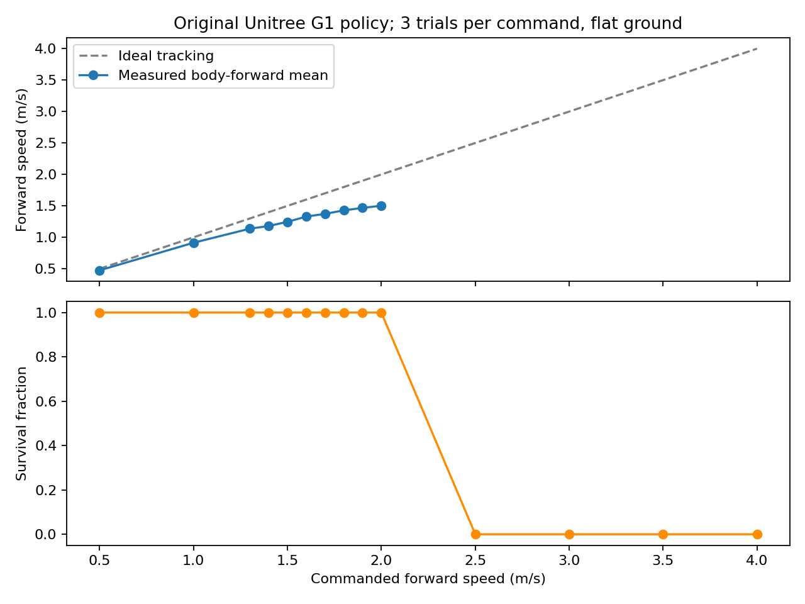

# Original Unitree G1 policy: measured speed envelope

Highest tested command meeting the defined tracking gate and 5/5 fresh-seed 60-second holds: **1.6 m/s**. Measured steady body-forward speed: **1.329 m/s** (4.79 km/h). Mean planar tracking RMSE: 0.303 m/s. This is a conditional tested operating point, not a global maximum.



## Protocol

No training or fine-tuning. Original Unitree `motion.pt`, pinned source commit `276801e46c5d433564f24658bac64f254b7d2d4b`, original Unitree 12-controlled-leg-DoF model with fixed upper body. This differs from the project’s Menagerie 29-actuator student model. Physics step 0.002 s, control step 0.02 s, official observation/action scaling, phase and PD gains. Terrain is flat, sliding friction 0.8; no pushes or domain randomization.

Each trial starts standing for 2 s, ramps the command over 3 s, then holds it for 30 s. Coarse commands: 0.5–4.0 m/s in 0.5 increments, seeds 70000–70002. Refinement: 1.3–2.0 m/s in 0.1 increments, seeds 70100–70102. Steady metrics exclude the first 10 s. Pass requires full survival, steady mean body-forward speed at least 80% of command, and planar RMSE no greater than max(0.2 m/s, 20% of command). Fall: pelvis height below 0.45 m, upright cosine below 0.45, or non-finite state. The selected command is checked with 60-second holds at fresh seeds 71000–71004. Seeds only change initial joint positions within ±0.005 rad; they are not diverse disturbances.

## Results

| Command | Survived / 3 | Tracking pass / 3 | Mean body vx | Mean world vx |
|---:|---:|---:|---:|---:|
| 0.5 | 3/3 | 3/3 | 0.475 | 0.461 |
| 1.0 | 3/3 | 3/3 | 0.914 | 0.873 |
| 1.3 | 3/3 | 3/3 | 1.138 | 1.139 |
| 1.4 | 3/3 | 3/3 | 1.179 | 1.181 |
| 1.5 | 3/3 | 3/3 | 1.247 | 1.252 |
| 1.6 | 3/3 | 3/3 | 1.329 | 1.336 |
| 1.7 | 3/3 | 0/3 | 1.373 | 1.351 |
| 1.8 | 3/3 | 0/3 | 1.429 | 1.165 |
| 1.9 | 3/3 | 0/3 | 1.468 | 0.812 |
| 2.0 | 3/3 | 0/3 | 1.503 | -0.316 |
| 2.5 | 0/3 | 0/3 | — | — |
| 3.0 | 0/3 | 0/3 | — | — |
| 3.5 | 0/3 | 0/3 | — | — |
| 4.0 | 0/3 | 0/3 | — | — |

## Limits and interpretation

At command 2.0 m/s, the robot survives the 30-second hold but averages only about 1.50 m/s in its own forward axis and drifts/turns strongly; world-x velocity can become negative. It is not successful straight-line tracking. Commands of 2.5 m/s and above fell in all tested coarse trials. Transient peaks before falling are not treated as sustainable speed. A 0.1 m/s refinement cannot identify an exact boundary between adjacent commands. Survival and forward tracking do not by themselves certify a running gait with a flight phase. No conclusion is made about physical G1 hardware limits, other Unitree policies, terrain robustness, abrupt acceleration, or performance on the project’s different robot model.

## Reproduce

```bash
MUJOCO_GL=egl EGL_PLATFORM=surfaceless MPLCONFIGDIR=/tmp/g1lab-mpl \
  .venv/bin/python scripts/benchmark_unitree_speed.py \
  --output artifacts/unitree-original-speed-v1
```

Fetch the optional pinned Unitree assets first using `scripts/fetch_teacher.sh`. Use a new output directory on rerun. The best-validated real-time MP4 and raw trajectory remain local; compact provenance and all per-trial results are retained under `experiment-data/unitree-original-speed-v1/`.
